# Backend Basics with Node.js — Project Guide

> A simple walkthrough of **everything this project does right now**: how it's set up, what every file does, and how a `GET` and a `POST` request travel through the code from start to finish.

> 💡 **Viewing the diagrams:** The flowcharts use [Mermaid](https://mermaid.js.org/). They render on GitHub automatically. In VS Code, install the **"Markdown Preview Mermaid Support"** extension, then open the preview with `Ctrl + Shift + V`.

---

## Table of Contents

1. [The Big Picture](#1-the-big-picture)
2. [Project Setup (Tooling)](#2-project-setup-tooling)
3. [Folder Structure](#3-folder-structure)
4. [The Layered Architecture](#4-the-layered-architecture-route--controller--service)
5. [File-by-File Explanation](#5-file-by-file-explanation)
6. [Life Cycle of a GET Request](#6-life-cycle-of-a-get-request)
7. [Life Cycle of a GET-by-ID Request](#7-life-cycle-of-a-get-by-id-request)
8. [Life Cycle of a POST Request](#8-life-cycle-of-a-post-request)
9. [Key Concepts Cheat Sheet](#9-key-concepts-cheat-sheet)
10. [Things to Notice (Learning Opportunities)](#10-things-to-notice-learning-opportunities)
11. [How to Test the API](#11-how-to-test-the-api)

---

## 1. The Big Picture

This project is a tiny **REST API** for products, built with **plain Node.js** (no Express!) and **TypeScript**.

It can:

| Method | URL              | What it does                      |
| ------ | ---------------- | --------------------------------- |
| `GET`  | `/`              | Returns a welcome message         |
| `GET`  | `/products`      | Returns **all** products          |
| `GET`  | `/products/:id`  | Returns **one** product by its id |
| `POST` | `/products`      | Creates a **new** product         |

Instead of a real database (like MongoDB or PostgreSQL), products are stored in a plain JSON file: `src/database/db.json`.

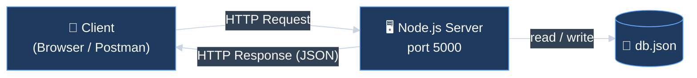

---

## 2. Project Setup (Tooling)

These are the steps you followed (also recorded in `notes.txt`):

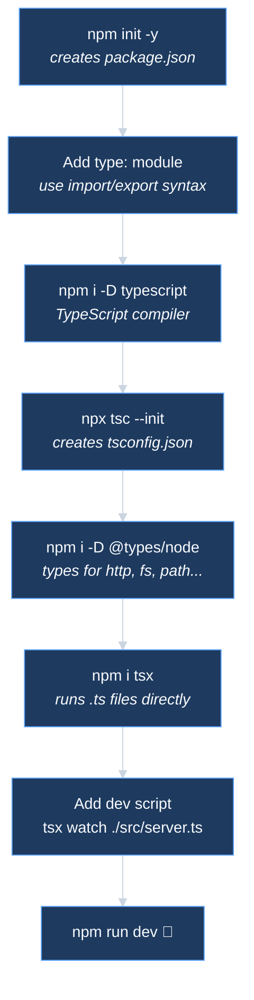

### What each tool does

| Tool / Setting          | Why it's needed                                                                                   |
| ----------------------- | ------------------------------------------------------------------------------------------------- |
| `"type": "module"`      | Lets you use modern `import x from "y"` instead of old `require("y")`.                             |
| `typescript`            | Adds types to JavaScript so mistakes are caught early.                                            |
| `@types/node`           | Teaches TypeScript what Node's built-in modules (`http`, `fs`, `path`) look like.                 |
| `tsx`                   | Runs TypeScript files **directly** without compiling to `.js` first.                              |
| `tsx watch`             | Restarts the server **automatically** every time you save a file.                                 |
| `tsconfig.json`         | Settings for TypeScript (see below).                                                              |

### Important `tsconfig.json` settings

| Setting                          | Meaning in simple words                                                              |
| -------------------------------- | ------------------------------------------------------------------------------------ |
| `"rootDir": "./src"`             | My source code lives in `src/`.                                                      |
| `"outDir": "./dist"`             | If I compile, put the JavaScript output in `dist/`.                                  |
| `"module": "esnext"`             | Use modern ES module syntax (`import`/`export`).                                     |
| `"moduleResolution": "bundler"`  | Lets you import files **without** writing `.ts`/`.js` at the end.                    |
| `"strict": true`                 | Turn on all the strict type checks — catches more bugs.                              |
| `"verbatimModuleSyntax": true`   | Forces `import type { ... }` when you only import a type (you'll see this a lot!).   |
| `"include": ["src/**/*.ts"]`     | Only look at `.ts` files inside `src`.                                               |

> 🧠 **Why `import type`?** Because of `verbatimModuleSyntax`, if you import something that is *only a type* (like `IncomingMessage` or `IProduct`), you must write `import type`. Types disappear when code runs, so this tells TypeScript "remove this import at runtime".

---

## 3. Folder Structure

```
Backend-Basics-With-Node/
├── notes.txt                  ← your setup notes
├── package.json               ← project info + scripts
├── tsconfig.json              ← TypeScript settings
└── src/
    ├── server.ts              ← 🚪 ENTRY POINT: creates & starts the server
    ├── route/
    │   └── route.ts           ← 🚦 decides WHERE a request should go
    ├── controller/
    │   └── product.controller.ts  ← 🧠 handles product requests (the logic)
    ├── service/
    │   └── product.service.ts     ← 💾 reads/writes the database file
    ├── database/
    │   └── db.json            ← 📄 the "database" (just a JSON file)
    ├── types/
    │   └── product.ts         ← 📐 the shape of a Product (TypeScript interface)
    ├── utils/
    │   └── parseBody.ts       ← 🛠️ helper to read the request body
    └── docs/
        └── project-guide.md   ← 📘 this file
```

---

## 4. The Layered Architecture (Route → Controller → Service)

Your notes end with: **"route, controller, service"**. This is the most important idea in the project. Each layer has **one job**:

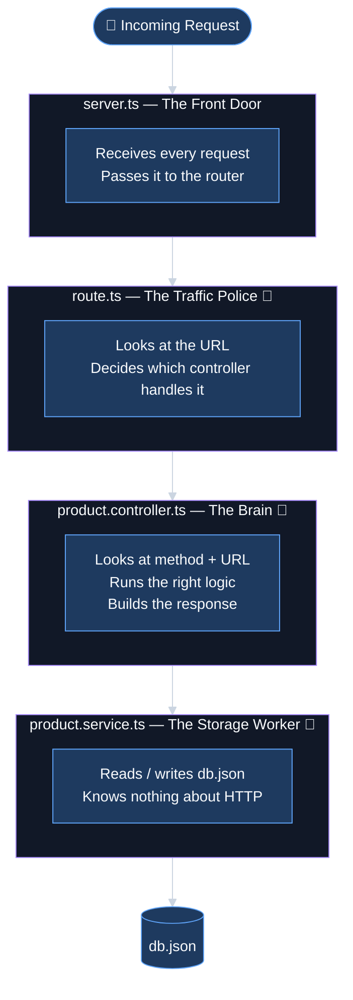

### A restaurant analogy 🍽️

| Layer          | Restaurant role | What it does                                                         |
| -------------- | --------------- | -------------------------------------------------------------------- |
| **Server**     | Front door      | Lets customers in.                                                   |
| **Route**      | Host / greeter  | "Products? Please go to the product table."                          |
| **Controller** | Waiter          | Takes your order, talks to the kitchen, brings back your food.       |
| **Service**    | Kitchen         | Actually gets the ingredients (data). Never talks to customers.      |
| **db.json**    | Fridge          | Where the ingredients (data) are stored.                             |

**Why split code like this?**
- Each file is small and easy to understand.
- If you later swap `db.json` for MongoDB, **only the service changes** — routes and controllers stay the same.
- Easier to find bugs: "Is it a routing problem, logic problem, or storage problem?"

---

## 5. File-by-File Explanation

### 5.1 `server.ts` — The Entry Point

```ts
import { createServer, IncomingMessage, Server, ServerResponse } from "node:http";
import routeHandler from "./route/route";

const server: Server = createServer((req: IncomingMessage, res: ServerResponse) => {
    routeHandler(req, res);
})

server.listen(5000, () => {
    console.log("Server is Running !")
})
```

- `createServer(callback)` — creates an HTTP server. The **callback runs once for every request**.
- `req` (**IncomingMessage**) — everything about the request: `req.url`, `req.method`, headers, body.
- `res` (**ServerResponse**) — the tool you use to send the answer back.
- `server.listen(5000)` — start listening on `http://localhost:5000`.

> Earlier (see `notes.txt`) all the `if/else` routing lived inside `server.ts`. You **refactored** it into `route.ts` so the server file stays clean. 👍

---

### 5.2 `route/route.ts` — The Router

```ts
if (url === '/' && method === "GET") {
    // reply with root message
} else if (url?.startsWith('/products')) {
    productController(req, res);   // hand off to the controller
} else {
    // reply "This route is not defined"
}
```

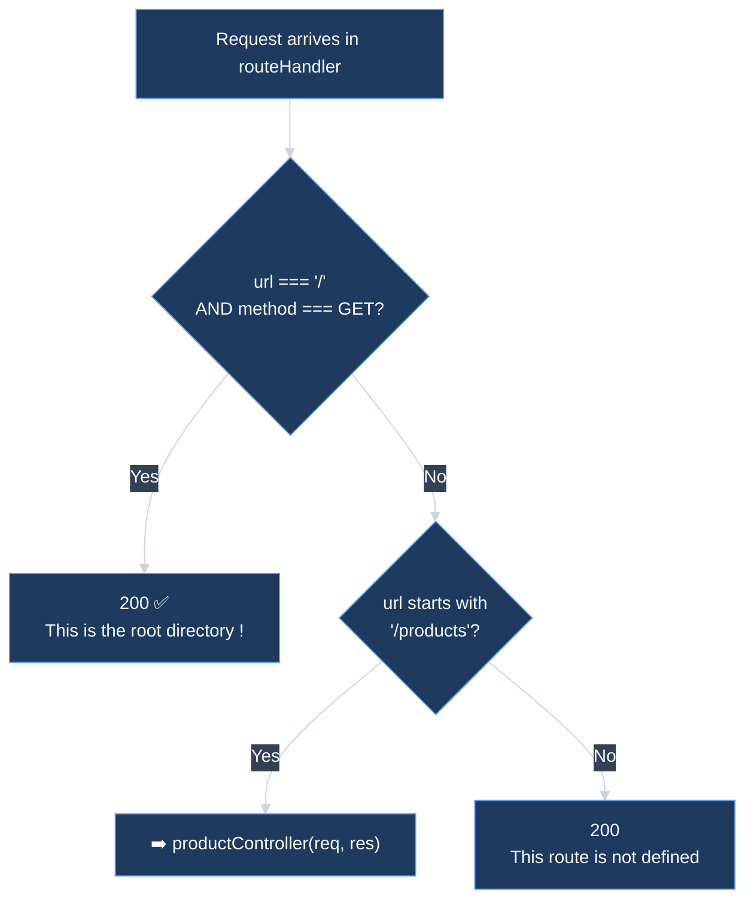

- `url?.startsWith(...)` — the `?.` (**optional chaining**) is used because TypeScript says `req.url` *might* be `undefined`.
- `startsWith('/products')` matches `/products`, `/products/1`, `/products/123`, etc.

---

### 5.3 `controller/product.controller.ts` — The Brain

**Step 1 — gather info (runs for every product request):**

```ts
const url = req.url;                       // e.g. "/products/2"
const method = req.method;                 // e.g. "GET"
const urlParams = url?.split('/');         // ["", "products", "2"]
const id = urlParams && urlParams[1] === "products" ? Number(urlParams[2]) : null;
const products = productService()          // read all products from db.json
```

How the `id` is extracted:

```
url        = "/products/2"
split('/') = [ ""  ,  "products" ,  "2" ]
               [0]       [1]        [2]
                                     │
                         Number("2") ▼
id         = 2
```

| URL              | `urlParams`               | `id`                           |
| ---------------- | ------------------------- | ------------------------------ |
| `/products`      | `["", "products"]`        | `Number(undefined)` → `NaN`    |
| `/products/2`    | `["", "products", "2"]`   | `2`                            |

> Notice: for `/products`, `id` is `NaN` (not `null`!). That's why the **"get all"** check comes **first** — order of `if` blocks matters here.

**Step 2 — decide what to do:**

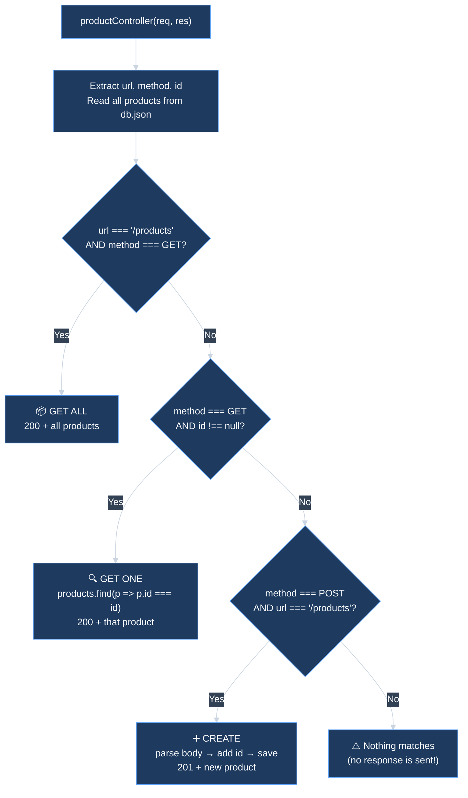

**Why is the controller `async`?** Because reading the POST body takes time (it arrives in pieces), so we `await bodyParser(req)`. Any function that uses `await` must be `async`.

---

### 5.4 `service/product.service.ts` — Talking to the Database

```ts
const filePath = path.join(process.cwd(), "src/database/db.json")

export const productService = () => {
    const result = fs.readFileSync(filePath, "utf-8");   // read file as text
    return JSON.parse(result);                           // text → JS array
}

export const createProduct = (payload: IProduct[]) => {
    fs.writeFileSync(filePath, JSON.stringify(payload)); // JS array → text → file
}
```

| Piece                    | Meaning                                                                         |
| ------------------------ | ------------------------------------------------------------------------------- |
| `process.cwd()`          | The folder where you ran `npm run dev` (the project root).                      |
| `path.join(...)`         | Builds a correct file path on any OS (Windows `\` or Mac/Linux `/`).            |
| `fs.readFileSync`        | Reads the file. **Sync** = waits until done before moving on.                   |
| `JSON.parse`             | Converts JSON **text** → JavaScript **object/array**.                           |
| `JSON.stringify`         | Converts JavaScript **object/array** → JSON **text**.                           |
| `fs.writeFileSync`       | **Overwrites** the whole file with the new content.                             |

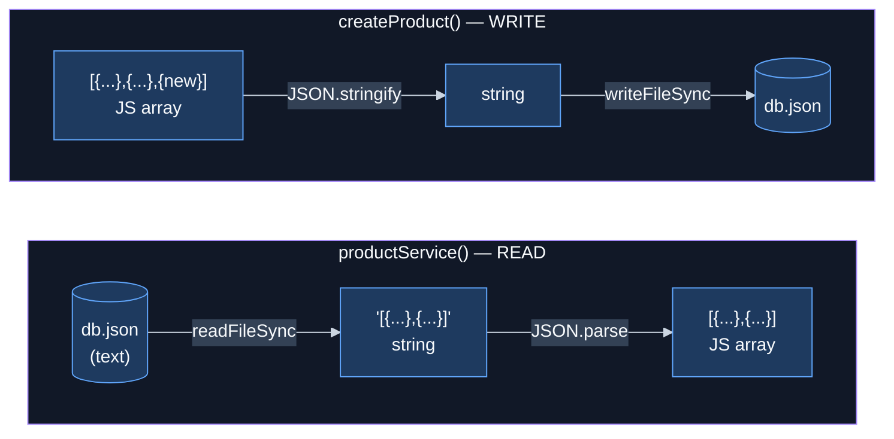

> 🔑 The service **knows nothing about HTTP** (no `req`, no `res`). It just reads and writes data. That's the whole point of the layer.

---

### 5.5 `utils/parseBody.ts` — Reading the Request Body

In plain Node.js, the request body does **not** arrive all at once. It comes as a **stream** of small pieces called **chunks**. You have to collect them yourself.

```ts
export const bodyParser = (req: IncomingMessage): Promise<any> => {
    let body = "";
    return new Promise((resolve, reject) => {
        req.on("data", (chunk) => {      // fires for EACH piece
            body = body + chunk;
        })
        req.on("end", () => {            // fires ONCE when all pieces arrived
            try {
                resolve(JSON.parse(body));   // ✅ success → give back the object
            } catch (error) {
                reject(error)                // ❌ bad JSON → fail the promise
            }
        })
    })
}
```

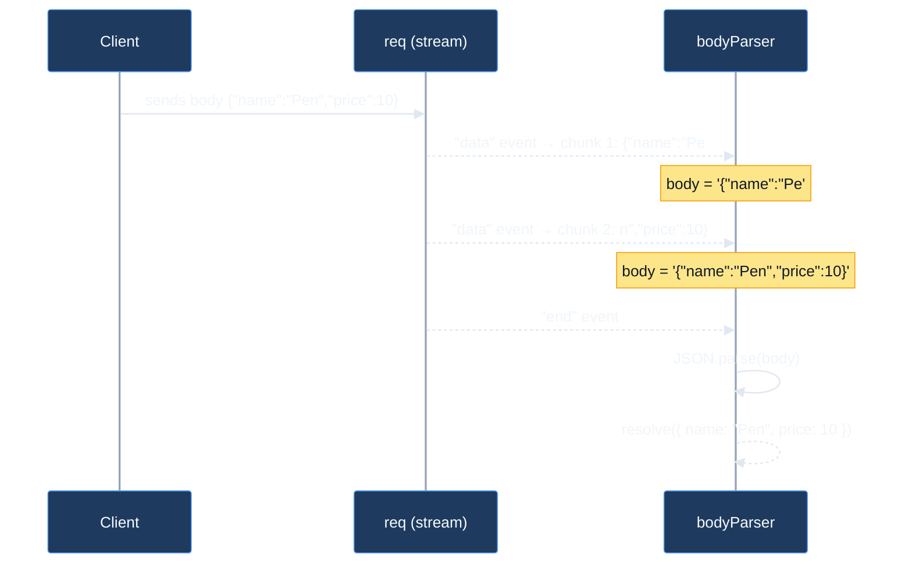

**Why wrap it in a Promise?** Events (`data`, `end`) happen *later*. A Promise lets the controller simply write `const body = await bodyParser(req)` and wait for the finished result.

> 📝 (Express does this for you with `express.json()`. Now you know what's happening under the hood!)

---

### 5.6 `types/product.ts` — The Shape of a Product

```ts
export interface IProduct {
    id: number;
    name: string
    price: number
}
```

An **interface** is a blueprint. It tells TypeScript "a product must have an `id` (number), a `name` (string) and a `price` (number)". It's used in:
- the service: `createProduct(payload: IProduct[])` — must receive an array of products.
- the controller: `products.find((p: IProduct) => ...)`.

> Interfaces exist **only at compile time**. They don't check data at runtime — so they can't stop a client from sending a product without a price (see section 10).

---

### 5.7 `database/db.json` — The "Database"

```json
[
  { "id": 1, "name": "Product 1", "price": 30 },
  { "id": 2, "name": "Product 2", "price": 45 },
  { "id": 1794915863635, "name": "Product 3" },
  { "id": 1794915896579, "name": "Product 3", "price": 60 }
]
```

- The first two were written by hand.
- The last two were created by your **POST** requests — their huge ids come from `Date.now()` (milliseconds since 1 Jan 1970).
- One of them has **no price** — a POST was sent without it, and nothing stopped it.

---

## 6. Life Cycle of a GET Request

**Request:** `GET http://localhost:5000/products`

### Step-by-step

| #  | Where                    | What happens                                                                                   |
| -- | ------------------------ | ---------------------------------------------------------------------------------------------- |
| 1  | Client                   | Sends `GET /products` to `localhost:5000`.                                                     |
| 2  | `server.ts`              | Node's `createServer` callback fires with `req` and `res`. Calls `routeHandler(req, res)`.     |
| 3  | `route.ts`               | Is it `/` + GET? ❌ Does url start with `/products`? ✅ → `productController(req, res)`.        |
| 4  | `product.controller.ts`  | Reads `url = "/products"`, `method = "GET"`, splits url, `id = NaN`.                           |
| 5  | `product.service.ts`     | `productService()` reads `db.json` and returns a JS array of products.                          |
| 6  | `product.controller.ts`  | First `if` matches (`url === "/products"` and GET). ✅                                          |
| 7  | `product.controller.ts`  | `res.writeHead(200, { "Content-Type": "application/json" })` — sets status & headers.          |
| 8  | `product.controller.ts`  | `res.end(JSON.stringify({ message, data: products }))` — sends the body and **closes** the response. |
| 9  | Client                   | Receives the JSON. 🎉                                                                           |

### Sequence diagram

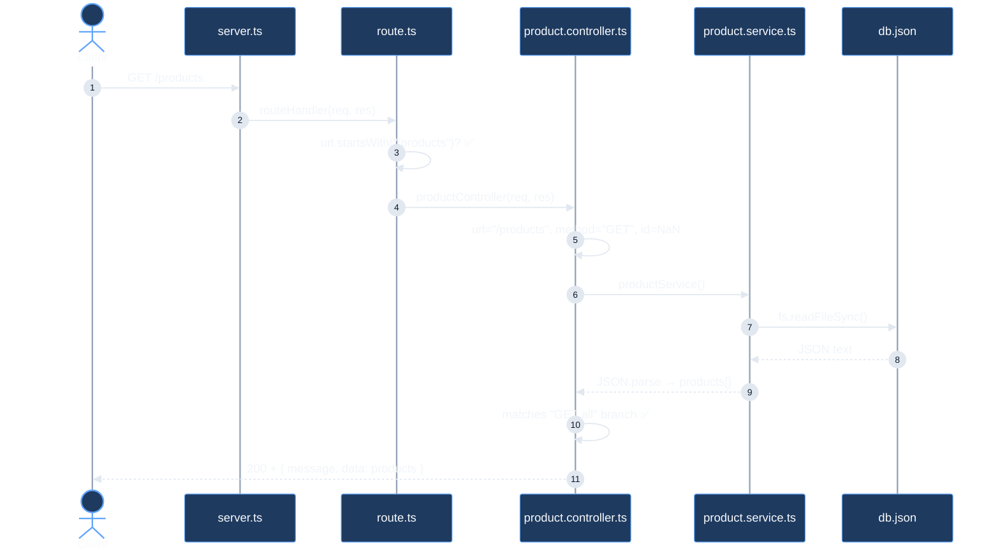

### Response

```json
{
  "message": "Products Retrived Successfully.",
  "data": [
    { "id": 1, "name": "Product 1", "price": 30 },
    { "id": 2, "name": "Product 2", "price": 45 },
    ...
  ]
}
```

---

## 7. Life Cycle of a GET-by-ID Request

**Request:** `GET http://localhost:5000/products/2`

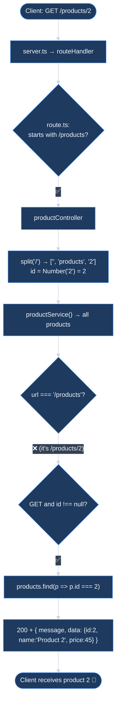

**Key idea:** the id lives **inside the URL** (`/products/2`). This is called a **route parameter** (in Express you'd write `/products/:id`). Here you extract it manually with `split('/')`.

---

## 8. Life Cycle of a POST Request

**Request:**

```
POST http://localhost:5000/products
Content-Type: application/json

{ "name": "Product 5", "price": 99 }
```

### Step-by-step

| #  | Where                    | What happens                                                                                 |
| -- | ------------------------ | -------------------------------------------------------------------------------------------- |
| 1  | Client                   | Sends `POST /products` with a JSON body.                                                     |
| 2  | `server.ts`              | Callback fires → `routeHandler(req, res)`.                                                   |
| 3  | `route.ts`               | URL starts with `/products` ✅ → `productController(req, res)`.                               |
| 4  | Controller               | `method = "POST"`, `url = "/products"`. Reads current products via `productService()`.        |
| 5  | Controller               | First two `if`s fail (they need GET). Third `if` (POST + `/products`) matches ✅.             |
| 6  | `parseBody.ts`           | `await bodyParser(req)` — collects chunks, waits for `end`, `JSON.parse` → `{ name, price }`. |
| 7  | Controller               | Builds `newProduct = { id: Date.now(), ...body }` (spread copies name & price in).            |
| 8  | Controller               | `products.push(newProduct)` — adds it to the array **in memory**.                             |
| 9  | `product.service.ts`     | `createProduct(products)` — writes the **whole** updated array back to `db.json`.             |
| 10 | Controller               | `res.writeHead(201, ...)` — **201 = Created**.                                                |
| 11 | Controller               | `res.end(JSON.stringify({ message, data: newProduct }))`.                                     |
| 12 | Client                   | Receives the new product with its generated id. 🎉                                            |

### Sequence diagram

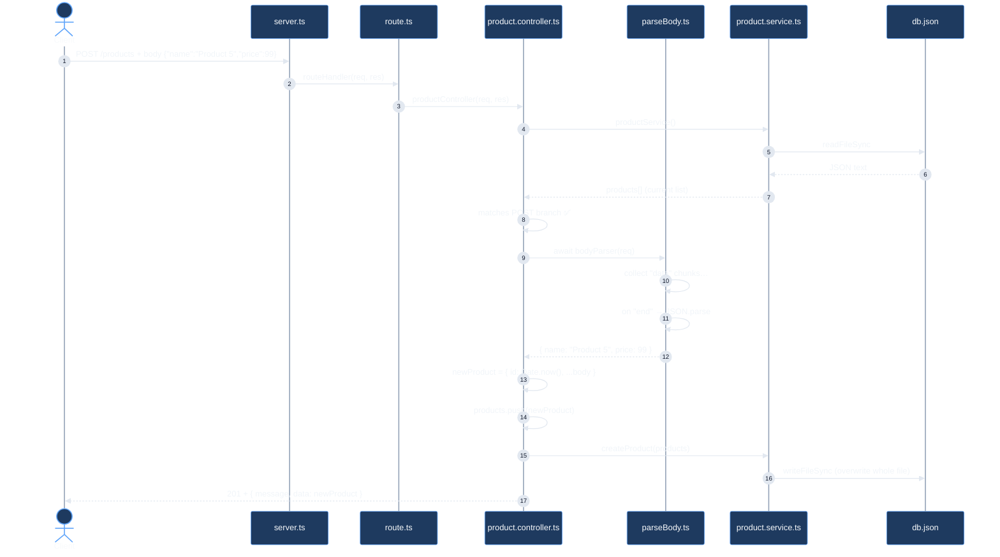

### What `{ id: Date.now(), ...body }` does

```
body       = { name: "Product 5", price: 99 }
Date.now() = 1794920000000

newProduct = { id: 1794920000000, name: "Product 5", price: 99 }
               └──── added ────┘  └────── spread from body ──────┘
```

### The data journey (Read → Modify → Write)

```mermaid
%%{init: {"theme": "base", "themeVariables": {"background": "#0f172a", "primaryColor": "#1e3a5f", "primaryTextColor": "#f8fafc", "primaryBorderColor": "#60a5fa", "secondaryColor": "#3b2f5c", "tertiaryColor": "#1e293b", "lineColor": "#cbd5e1", "textColor": "#f1f5f9", "mainBkg": "#1e3a5f", "nodeBorder": "#60a5fa", "clusterBkg": "#111827", "clusterBorder": "#a78bfa", "titleColor": "#f8fafc", "edgeLabelBackground": "#334155", "fontSize": "15px", "actorBkg": "#1e3a5f", "actorBorder": "#60a5fa", "actorTextColor": "#f8fafc", "actorLineColor": "#94a3b8", "signalColor": "#e2e8f0", "signalTextColor": "#f1f5f9", "labelBoxBkgColor": "#1e3a5f", "labelBoxBorderColor": "#60a5fa", "labelTextColor": "#f8fafc", "loopTextColor": "#f1f5f9", "noteBkgColor": "#fde68a", "noteTextColor": "#111827", "noteBorderColor": "#f59e0b", "activationBkgColor": "#334155", "sequenceNumberColor": "#0f172a"}}}%%
flowchart LR
    A[("db.json<br/>4 products")] -- "1 READ<br/>productService()" --> B["products[]<br/>(4 items, in memory)"]
    B -- "2 MODIFY<br/>push(newProduct)" --> C["products[]<br/>(5 items, in memory)"]
    C -- "3 WRITE<br/>createProduct()" --> D[("db.json<br/>5 products")]
```

> This **Read → Modify → Write** pattern is how every file-based "database" works. Real databases do this for you (and much more safely).

### Response

```json
{
  "message": "Products Retrived Successfully.",
  "data": { "id": 1794920000000, "name": "Product 5", "price": 99 }
}
```

---

## 9. Key Concepts Cheat Sheet

| Concept                  | One-line explanation                                                                     |
| ------------------------ | ---------------------------------------------------------------------------------------- |
| **HTTP method**          | The *verb*: `GET` = read, `POST` = create (later: `PUT`/`PATCH` = update, `DELETE`).     |
| **URL / route**          | The *address* of the resource, e.g. `/products/2`.                                       |
| **Route parameter**      | A variable part of the URL, like the `2` in `/products/2`.                               |
| **Request body**         | Data the client sends (used with POST). Arrives as a **stream**.                         |
| **Stream / chunk**       | Data that arrives in small pieces over time instead of all at once.                      |
| **Status code**          | `200` OK, `201` Created, `404` Not Found, `400` Bad Request, `500` Server Error.          |
| **Header**               | Extra info about the response, e.g. `Content-Type: application/json`.                    |
| **`res.writeHead()`**    | Sets the status code and headers.                                                         |
| **`res.end()`**          | Sends the body and **finishes** the response. Every request must end with this!          |
| **`JSON.stringify`**     | Object → text (to send or save).                                                         |
| **`JSON.parse`**         | Text → object (to use in code).                                                          |
| **Promise / async-await**| A way to wait for something that finishes later (like reading the body).                 |
| **Sync vs Async fs**     | `readFileSync` blocks until done; `fs.promises.readFile` lets other work continue.       |
| **Separation of concerns** | Route → Controller → Service: each layer has one job.                                  |

---

## 10. Things to Notice (Learning Opportunities)

These aren't "mistakes" for this stage — they're natural next steps, and most tutorials fix them later. Try spotting them yourself!

| #  | What you'll notice                                                                                                                                         | Try this                                                                                     |
| -- | ---------------------------------------------------------------------------------------------------------------------------------------------------------- | -------------------------------------------------------------------------------------------- |
| 1  | **Unknown routes return `200`.** In `route.ts`, "This route is not defined" uses status `200` (OK).                                                         | Use `404` (Not Found).                                                                       |
| 2  | **Request can hang forever.** If you send e.g. `DELETE /products`, no `if` in the controller matches, so `res.end()` is never called. The client keeps waiting. | Add a final `else` that sends `404` or `405`.                                                |
| 3  | **Product not found still says success.** `GET /products/999` → `find` returns `undefined` → `200` with no `data`.                                          | If `!product`, send `404` with a message.                                                    |
| 4  | **Non-number ids.** `GET /products/abc` → `Number("abc")` is `NaN`, which is `!== null`, so it goes into the GET-by-id branch and finds nothing.            | Check `isNaN(id)` and send `400`.                                                            |
| 5  | **No validation on POST.** A product without `price` was saved (see `db.json`). The `IProduct` interface can't stop it because types don't exist at runtime. | Check `body.name` and `body.price` before saving; send `400` if missing.                     |
| 6  | **Bad JSON crashes the server.** If the POST body is invalid JSON, `bodyParser` rejects, nobody catches it, and Node exits with an unhandled rejection.     | Wrap `await bodyParser(req)` in `try/catch` and send `400`.                                  |
| 7  | **Copy-paste message.** The POST response says `"Products Retrived Successfully."`                                                                          | Change to `"Product created successfully."` (also: "Retrived" → "Retrieved").                |
| 8  | **Sync file functions block.** `readFileSync`/`writeFileSync` pause the whole server while working. Fine for learning, slow with many users.               | Later, try `fs.promises.readFile` with `await`.                                              |

---

## 11. How to Test the API

Start the server:

```bash
npm run dev
# → Server is Running !
```

Then use **Postman**, **Thunder Client** (VS Code extension), or `curl`:

```bash
# Root
curl http://localhost:5000/

# Get all products
curl http://localhost:5000/products

# Get one product
curl http://localhost:5000/products/2

# Create a product
curl -X POST http://localhost:5000/products \
     -H "Content-Type: application/json" \
     -d '{"name":"Product 5","price":99}'
```

After the POST, open `src/database/db.json` — you'll see your new product saved there. ✅

---

### 🧭 One-picture summary

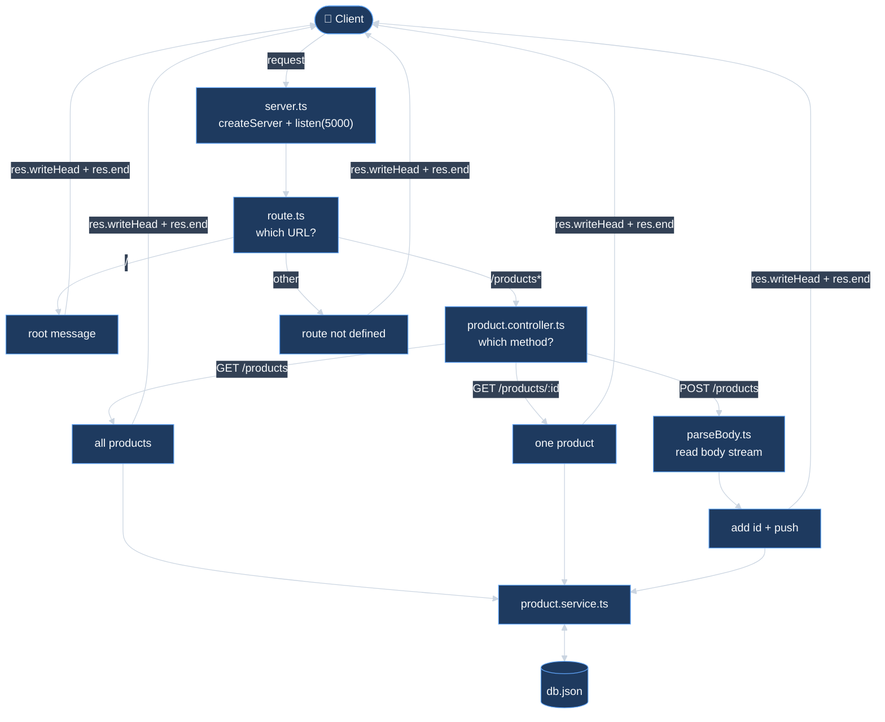

Happy learning! 🚀
